<h1 align="center">Topic Model (LDA)</h1>

<p align="center">
  <em>Latent Dirichlet allocation, built from scratch: collapsed Gibbs sampling for topic discovery, with UMass topic-coherence evaluation.</em>
</p>

<p align="center">
  <a href="https://github.com/adeoluo/topic-model-lda/actions/workflows/ci.yml"></a>
  
  
  
  
  
</p>

---

## Motivation

Topic models discover the themes running through a collection of documents without any
labels. Latent Dirichlet allocation is the canonical one: it treats each document as a
mixture of topics and each topic as a distribution over words, and infers both from the text
alone. This project implements LDA **from first principles** using **collapsed Gibbs
sampling**, with **zero runtime dependencies** and a deterministic, offline test suite. The
only inference primitive is sampling a token's topic from its full conditional.

## Architecture

<p align="center">
  
</p>

Every word token starts with a random topic. Collapsed Gibbs sampling repeatedly resamples
each token's topic from its full conditional, which depends only on the current topic-word
and document-topic counts. After convergence those counts give the topics and the per-document
topic mixtures. See the [ADRs](docs/adr/) for the key decisions.

## How collapsed Gibbs sampling works

The topic-word and document-topic distributions are integrated out analytically, so sampling
needs only integer counts. Each token's topic is resampled with probability

```
p(topic = k | ...) proportional to
    (n_dk + alpha) * (n_kw + beta) / (n_k + V * beta)
```

where `n_dk` is topic `k`'s count in document `d`, `n_kw` is word `w`'s count in topic `k`,
and `n_k` is topic `k`'s total. The first factor pulls a token toward topics already common
in its document; the second toward topics where its word is already common.

## Results

> Reproduce with `python -m topic_model_lda topics`. On a collection with three latent themes
> (space, cooking, finance), LDA recovers them as distinct, coherent topics.

```text
topic 0: rocket, orbit, mission, satellite, planet, launch
topic 1: bake, flour, oven, sauce, dish, recipe
topic 2: portfolio, price, trade, bank, stock, profit
```

Each discovered topic is dominated by a single theme, and every theme is recovered as a
separate topic - with no supervision. Topic coherence is reported by
`python -m topic_model_lda evaluate` (UMass; higher, closer to zero, is better).

## Quickstart

```bash
git clone https://github.com/adeoluo/topic-model-lda.git && cd topic-model-lda
make setup                    # install dev tooling + pre-commit hooks
make all                      # lint + type-check + test

python -m topic_model_lda topics                  # top words of each discovered topic
python -m topic_model_lda evaluate                # mean topic coherence
```

Model your own documents:

```python
from topic_model_lda import LDA, LDAConfig, Corpus

corpus = Corpus.from_texts(["your first document ...", "another document ..."])
model = LDA(corpus, LDAConfig(num_topics=5, iterations=300))
model.train()
print(model.topic_words(0, k=8))
```

## Running the service

A dependency-free HTTP service trains the model once at startup and serves topic queries:

```bash
python -m topic_model_lda serve --port 8000

curl localhost:8000/topics
curl -s -X POST localhost:8000/infer -d '{"text": "rocket orbit planet galaxy"}'
curl localhost:8000/evaluate
```

See the [operations guide](docs/OPERATIONS.md) for the service contract and constraints.
The service also exposes `GET /ready` (readiness) and `GET /metrics` (per-route request,
error, and latency metrics in Prometheus text format). A production-style stress benchmark
(`uv run python benchmarks/stress.py`) reports throughput and p50/p95/p99 latency; the
scaling path and tradeoffs are in [docs/SCALING.md](docs/SCALING.md) and a full walk-through
is in the [case study](docs/CASE_STUDY.md).

## Components

- **corpus** - tokenization with stopword removal and an integer-indexed document collection.
- **lda** - collapsed Gibbs sampling with topic-word and document-topic queries.
- **data** - a themed document collection.
- **evaluation** - UMass topic coherence from the training documents.

## Design decisions

- **Collapsed Gibbs sampling.** Integrating out the distributions lets inference run on integer
  counts, which is simple and mixes well. ([ADR-0002](docs/adr/0002-collapsed-gibbs.md))
- **Intrinsic coherence, no external corpus.** UMass coherence is computed from the training
  documents, so evaluation is self-contained. ([ADR-0003](docs/adr/0003-intrinsic-coherence.md))

## Responsible AI

- **Model card:** [docs/MODEL_CARD.md](docs/MODEL_CARD.md)
- **Data card:** [docs/DATA_CARD.md](docs/DATA_CARD.md)
- **Threat model:** [docs/THREAT_MODEL.md](docs/THREAT_MODEL.md)

## Limitations

- The number of topics is a hyperparameter, not inferred; nonparametric variants learn it.
- Training is pure Python, suited to learning and modest collections.
- The bundled documents are synthetic with clear themes; real text is messier.

## Roadmap

- [ ] Hyperparameter estimation for alpha and beta
- [ ] Perplexity on held-out documents alongside coherence
- [ ] Online variational inference for larger collections

## License

[MIT](LICENSE). Part of an artificial intelligence engineering portfolio by
[adeoluo](https://github.com/adeoluo).
