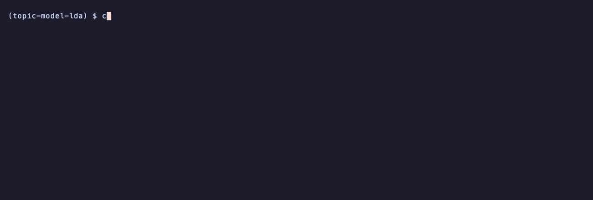
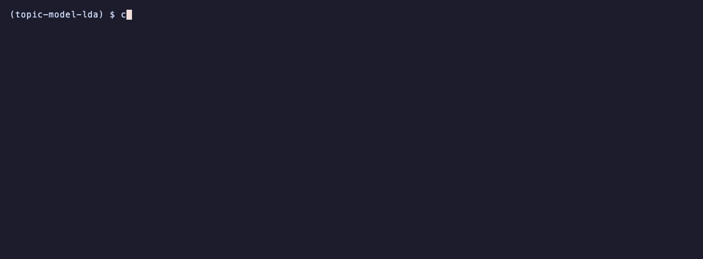

<h1 align="center">Topic Model (LDA)</h1>

<p align="center">
  <em>Latent Dirichlet allocation, built from scratch: collapsed Gibbs sampling for topic discovery, with a Rust core that reproduces the Python sampler exactly, and UMass topic-coherence evaluation.</em>
</p>

<p align="center">
  <a href="https://github.com/adeoluo/topic-model-lda/actions/workflows/ci.yml"></a>
  <a href="https://github.com/adeoluo/topic-model-lda/releases"></a>
  
  
  <a href="LICENSE"></a>
</p>

---

## Motivation

Topic models discover the themes running through a collection of documents without any
labels. Latent Dirichlet allocation is the canonical one: it treats each document as a
mixture of topics and each topic as a distribution over words, and infers both from the text
alone. This project implements LDA **from scratch** using **collapsed Gibbs
sampling**, with a deterministic, offline test suite. The
only inference primitive is sampling a token's topic from its full conditional.

## Architecture

<p align="center">
  
</p>

<sub>Legend: amber = entry points and external systems, indigo = core logic, green = data and state, blue = validation and control, grey = observability and outputs.</sub>

The bundled documents are tokenized into an integer-indexed corpus, and every word token
starts with a random topic. Collapsed Gibbs sampling repeatedly resamples each token's topic
from its full conditional, which depends only on the current topic-word and document-topic
counts. After convergence those counts give the topics and the per-document topic mixtures;
the service reads them to list top words and to infer topics for a validated new document,
UMass coherence scores the topics, and every route is counted in the Prometheus metrics. See
the [ADRs](docs/adr/) for the key decisions.

### How collapsed Gibbs sampling works

The topic-word and document-topic distributions are integrated out analytically, so sampling
needs only integer counts. Each token's topic is resampled with probability

```
p(topic = k | ...) proportional to
    (n_dk + alpha) * (n_kw + beta) / (n_k + V * beta)
```

where `n_dk` is topic `k`'s count in document `d`, `n_kw` is word `w`'s count in topic `k`,
and `n_k` is topic `k`'s total. The first factor pulls a token toward topics already common
in its document; the second toward topics where its word is already common.

### Components

- **corpus** - tokenization with stopword removal and an integer-indexed document collection.
- **lda** - collapsed Gibbs sampling with topic-word and document-topic queries.
- **data** - a themed document collection.
- **evaluation** - UMass topic coherence from the training documents.

## Results

> Reproduce with `python -m topic_model_lda topics`. On a collection with three latent themes
> (space, cooking, finance), LDA recovers them as distinct, coherent topics.

```text
topic 0: rocket, orbit, mission, satellite, planet, launch
topic 1: bake, flour, oven, sauce, dish, recipe
topic 2: portfolio, price, trade, bank, stock, profit
```

Each discovered topic is dominated by a single theme, and every theme is recovered as a
separate topic - with no supervision. Topic coherence is reported by
`python -m topic_model_lda evaluate` (UMass; higher, closer to zero, is better).

### Real web text (C4) and the Rust core

> Reproduce with `make rust-develop`, download one C4 shard
> (`https://huggingface.co/datasets/allenai/c4/resolve/main/en/c4-train.00000-of-01024.json.gz`),
> then `uv run --no-sync --with gensim python benchmarks/compare_backends.py --c4 <shard> --gensim`.
> Apple M1, 8 cores. Documents are the first C4 English documents, truncated to 300 words, with
> rare and near-universal words pruned. Raw numbers: [benchmarks/results.json](benchmarks/results.json).

The optional Rust core draws from a port of CPython's Mersenne Twister and totals the weights the
way the running interpreter's `sum()` does, so it produces the same topic assignments as the Python
sampler, token for token. The parity tests check this in CI.

| Sampler | Documents | Tokens | Sweeps | Time | Tokens per second | Same assignments |
|---|---:|---:|---:|---:|---:|:---:|
| Python | 1,000 | 108,767 | 5 | 1.6 s | 344,298 | yes |
| Rust | 1,000 | 108,767 | 5 | 0.04 s | 12,634,177 (**37x**) | yes |

At scale, the Rust sampler trains 20 topics on 20,000 C4 documents
(15,726 words, 2,347,084 tokens) for 100
sweeps in 17.4 seconds. Against gensim, the most widely used Python LDA library,
on the same documents and vocabulary, with every model's top eight words scored by the same UMass
function:

| Library | Algorithm | Train time | Mean UMass (top 8, higher is better) |
|---|---|---:|---:|
| **topic-model-lda, Rust** | collapsed Gibbs, 100 sweeps | **17.4 s** | -53.55 |
| gensim LdaModel, 1 process | online variational Bayes, 10 passes | 36.7 s | -56.78 |
| gensim LdaMulticore, 7 workers | online variational Bayes, 10 passes | 26.9 s | **-47.93** |

The Rust sampler is the fastest of the three and more coherent than single-process gensim, but
multicore gensim reaches better coherence at these settings. The Rust sampler runs on one core;
the Gibbs chain is sequential by construction, which is what makes the exact reproduction possible.

The learned topics (top eight words):

```text
topic  0: 1 year 2 5 3 4 10 6
topic  1: he his her she who him life family
topic  2: home room house hotel area space design table
topic  3: food add into water wine until make cream
topic  4: skin body water health treatment used energy which
topic  5: our music up their day love new great
topic  6: data which its these market technology system new
topic  7: they if what do t when there their
topic  8: car insurance if property vehicle get available road
topic  9: he his said had were their after who
topic 10: made black size set color x white back
topic 11: school students their university program our education training
topic 12: game 1 video 2 mobile app new software
topic 13: i my t so me what about just
topic 14: our online business free design get best marketing
topic 15: book m d de new p 2019 art
topic 16: our services service us quality work care provide
topic 17: its city world south which many also north
topic 18: if any information use please may site other
topic 19: its business government company law public their financial
```

### Scale

`benchmarks/scale.py` runs collapsed Gibbs sampling over progressively larger synthetic
document collections at a fixed iteration count and records wall-clock time, training
throughput, peak memory (`tracemalloc`), and mean UMass coherence. Timing is measured without
tracemalloc (which slows every allocation); peak memory is traced separately around the corpus,
model construction, and a single sweep, which is faithful because the token assignments and
count matrices are allocated up front and reused each iteration. Throughput is roughly flat near
165 to 270 documents per second, peak memory grows linearly, and coherence stays stable as the
corpus grows. Run with `uv run python benchmarks/scale.py`.

| Documents | Seconds | Throughput (docs/sec) | Peak memory (MiB) | Coherence (UMass) |
|---:|---:|---:|---:|---:|
| 200 | 0.73 | 272.5 | 0.19 | -3.890 |
| 400 | 1.66 | 240.8 | 0.37 | -3.899 |
| 800 | 4.85 | 165.0 | 0.73 | -4.242 |
| 1600 | 6.39 | 250.5 | 1.46 | -4.286 |

Honest caveat: the documents are synthetic with three clear themes, and this Python
implementation is not benchmarked against compiled topic-model libraries.

## Quickstart

```bash
git clone https://github.com/adeoluo/topic-model-lda.git && cd topic-model-lda
make setup                    # install dev tooling + pre-commit hooks
make all                      # lint + type-check + test

python -m topic_model_lda topics                  # top words of each discovered topic
python -m topic_model_lda evaluate                # mean topic coherence
```

Model your own documents:

```python
from topic_model_lda import LDA, LDAConfig, Corpus

corpus = Corpus.from_texts(["your first document ...", "another document ..."])
model = LDA(corpus, LDAConfig(num_topics=5, iterations=300))
model.train()
print(model.topic_words(0, k=8))
```

## Usage

### HTTP service

A standard-library HTTP service trains the model once at startup and serves topic queries:

```bash
python -m topic_model_lda serve --port 8000

curl localhost:8000/topics
curl -s -X POST localhost:8000/infer -d '{"text": "rocket orbit planet galaxy"}'
curl localhost:8000/evaluate
```

See the [operations guide](docs/OPERATIONS.md) for the service contract and constraints.
The service also exposes `GET /ready` (readiness) and `GET /metrics` (per-route request,
error, and latency metrics in Prometheus text format). A production-style stress benchmark
(`uv run python benchmarks/stress.py`) reports throughput and p50/p95/p99 latency; the
scaling path and tradeoffs are in [docs/SCALING.md](docs/SCALING.md) and a full walk-through
is in the [case study](docs/CASE_STUDY.md).

### Demos

Recorded from real runs with [vhs](https://github.com/charmbracelet/vhs); each tape is in `docs/demo/`.

Topics discovered by collapsed Gibbs sampling, and their coherence.

<p align="center">
  
</p>

The HTTP service inferring the topic mix of two new documents.

<p align="center">
  
</p>

Topics and coherence from the service, and its request metrics.

<p align="center">
  
</p>

## Design decisions

- **A Rust core that reproduces the Python sampler exactly.** Gibbs sampling is a long
  sequential loop over tokens, which interpreted Python runs slowly. The Rust core ports
  CPython's random number generator and summation so the two produce identical topic
  assignments, checked in CI. ([ADR-0004](docs/adr/0004-rust-core-exact-reproduction.md))
- **Collapsed Gibbs sampling.** Integrating out the distributions lets inference run on integer
  counts, which is simple and mixes well. ([ADR-0002](docs/adr/0002-collapsed-gibbs.md))
- **Intrinsic coherence, no external corpus.** UMass coherence is computed from the training
  documents, so evaluation is self-contained. ([ADR-0003](docs/adr/0003-intrinsic-coherence.md))

## Testing

```bash
make lint        # ruff format --check and ruff check
make type        # mypy src (strict)
make test        # pytest
make coverage    # pytest with an 80% coverage gate
```

The suite in `tests/` has the following tests:

- `test_core.py`: tokenization (stopwords, Unicode, digits, underscores), corpus indexing, configuration validation, recovery of coherent topics on the themed collection, document-topic mixtures summing to one, and coherence computation.
- `test_rust_parity.py`: the Rust sampler's topic assignments, topic-word counts, and
  document-topic mixtures equal the Python sampler's for several seeds (including a seed
  wider than 32 bits), topic counts, and hyperparameters, before and after training.
- `test_service.py`: the HTTP routes through the handler layer (no socket), inference assigning the dominant topic, rejection of empty input, normalization on long documents, metrics, and unknown routes.

CI (`.github/workflows/ci.yml`) runs format, lint, type check, and the coverage-gated tests on Python 3.11 and 3.12, then builds the package and the Docker image. A separate job runs `cargo fmt`, `clippy`, and
`cargo test`, builds the extension, and runs the parity tests with the extension required.
CodeQL runs in `codeql.yml`.

## Responsible AI

- **Model card:** [docs/MODEL_CARD.md](docs/MODEL_CARD.md)
- **Data card:** [docs/DATA_CARD.md](docs/DATA_CARD.md)
- **Threat model:** [docs/THREAT_MODEL.md](docs/THREAT_MODEL.md)

## Limitations

- The number of topics is a hyperparameter, not inferred; nonparametric variants learn it.
- The Python sampler is interpreted and suited to modest collections; the Rust core is 37x
  faster but still single threaded, and multicore gensim reaches better coherence on C4.
- The bundled documents are synthetic with clear themes; real text is messier.

## Roadmap

- [ ] Hyperparameter estimation for alpha and beta
- [ ] Perplexity on held-out documents alongside coherence
- [x] A compiled sampler (Rust core, identical results to the Python sampler).
- [ ] A parallel approximate sampler (AD-LDA) for multi-core training.
- [ ] Online variational inference for larger collections

## License

Released under the [MIT License](LICENSE).
